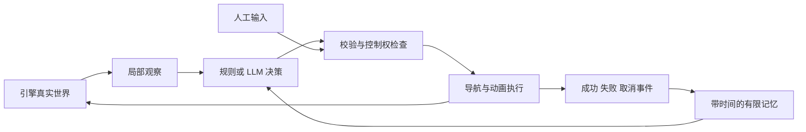

# 小庭院仿真阶段：研究与执行计划

## W4 · 一条线索的后来 · 2026-11-13

运行 `./living_world/w4.command`，打开 <http://127.0.0.1:4198/>。亲手给一次线索，再逐段观察亲历、传给同伴和下一次选择；同步查看没有干预的世界。支持换人、换地点与导入 W2。61 项回归与 13 项浏览器检查通过，主观易懂程度待体验。[计划、进展与截图](sim/living-world/w4-story/PROGRESS.md)。

## 26 对世界的节奏诊断 · 2026-11-12

14 对出发次数相同、只是同序游程错开；12 对还存在次数差异。27 个受影响角色的偏移在延长观察中均保持，末段时差由累计不适取食次数差对应的饥饿恢复量解释。对齐身体日程与抽样序号后，保留记忆的 600 步探针未再分开。[逐案结果与验证](sim/living-world/w3-rhythm/PROGRESS.md)。

## 按出发次数配对探索 · 2026-11-12

完成全部 640 条件、5120 条世界轨迹的对照。效果互换组仍有 14/256 对出现依赖交流的同伴行为变化；末段可配对出发的地点分歧为 0，终点仍有 26 对身体状态不同。未配对尾部单列，不能称为完全趋同。[结果、实例与验证](sim/living-world/w3-coupling/PROGRESS.md)。

## 三次改选的直接原因 · 2026-11-11

三对邻近游程中的改选均触发偶尔探索。六次出发的亲历和有效消息都偏向紫穗；只关闭本次探索，六次均选紫穗。种子 19 的两对共享抽样，不能算作独立重复。[逐次证据与反事实](sim/living-world/w3-attribution/PROGRESS.md)。游程诊断与本轮归因结果均已保存到 GitHub，固定提交见进展记录。

## 第 +2640 步的 11 对世界

12 名状态有差异的角色最近一趟在两侧都选同地。7 对可用固定时差对齐，1 对邻近三趟同地但时差变化，3 对邻近游程有地点分歧。[游程图](sim/living-world/w3-endpoint/review/index.html) · [计划与结果](sim/living-world/w3-endpoint/PROGRESS.md)。

## W3 延长观察

从第 +240 步仍有行为差异的 45 对世界继续到 +2640。两个人在两边最终都常去相同地点，末步仍有 11 对出现行动差异。图中可以查看每次实际出发。[结果与复现](sim/living-world/w3-long/PROGRESS.md) · [离线结果页](sim/living-world/w3-long/review/index.html)。

## W3 同档分支 · 2026-11-09

运行 `./living_world/w3.command` 后打开 <http://127.0.0.1:4195/>。从同一个 W2 存档同时观察自由生活与一条私下建议的后果，沿时间轴检查消息和选择。主比较 384 对中 65 对改变收件人行为，同伴改选 0 对。效果互换补充比较 256 对中 18 对出现依赖交流的同伴改选。[计划](sim/living-world/w3/PLAN.md) · [进展与证据](sim/living-world/w3/PROGRESS.md)。

## 当前阶段 W2 · 两种天气下的个人经验（2026-11-06）

运行 `./living_world/w2.command` 后打开 <http://127.0.0.1:4194/>，点击“载入双人示例”即可观察经历如何影响下一次出发。两种天气的亲历与同伴消息分别保存，玩家可切换天气、调整食物及给单人线索。32 个种子自由生活后段的平均有益取食率为 73.5%，合并天气记忆对照为 44.6%。[计划](sim/living-world/w2/PLAN.md) · [进展与证据](sim/living-world/w2/PROGRESS.md)。

## W1 两角色实时小世界（2026-11-06）

用户已授权第一阶段并要求先计划再实施。独立二维实时世界已实现：自行移动/取食/休息、环境供给与效果修改、单角色地点线索、独立记忆和存档。15 项核心/HTTP 检查及 12 项独立 Chromium 检查通过，涵盖 JSON 文件往返与控制稳定性。趣味性待反馈。[计划](sim/living-world/PLAN.md) · [进展与边界](sim/living-world/PROGRESS.md) · [启动说明](../living_world/README.md)。原 E1–E6 和 Godot/Blender 保留，不自动扩展第二阶段。

## E6 未解决异常收束（2026-11-04）

E1–E5 已先保存 [GitHub 固定归档](https://github.com/jjdak/VirtualPet/tree/agent-lab-e1-e5-2026-11-02)，提交 `ac3c2fd`；见[远端回执](archive/agent-lab-e1-e5/REMOTE_RECEIPT.json)。E6 完成 6,080 组/218.88 万次选择、14 项测试、全量复算与浏览器检查。保留事项修复已知 swap@77 漏查（恢复中位 37→9），但新时刻未优于同触发短期对照，噪声下有额外成本。见[计划](sim/experiments/e6/PLAN.md)、[结果与限制](sim/experiments/e6/PROGRESS.md)。本轮收束，不自动开始 E7；主观体验待反馈。

## E5 自适应复查频率（2026-11-02）

已完成根据亲历复查收益调整间隔，与固定 12/18/30 对照。26 情景、5,200 组、187.2 万次选择，12 项测试、全量复算和浏览器检查通过。稳定时少查，但隐蔽变化发现更晚；新时刻中自适应总损失 19.14，高于固定 30 的 11.94，未证实优于简单基线。已定位旧意外门槛在近期复查后的盲点，保留负结果，不继续按分数调参。见[计划](sim/experiments/e5/PLAN.md)、[结果与限制](sim/experiments/e5/PROGRESS.md)。E1–E4 冻结、无新依赖/模型调用，下一实验仅记录建议，用户体验待反馈。

## E4 有预算的混合复查（2026-11-01）

已完成用户授权的偶尔复查＋意外优先、预算/冷却/保留额度，以及不同变化时刻、非同步变化对照。3,500 组、126 万次选择、14 项测试、全量复算与浏览器回放通过。混合在 14 情景等权平均下比预算随机少尝试约 28%、总损失少约 11%，但稳定与无噪声非同步环境更差，相对仅偶尔复查的优势集中于早期突变；不宣称普遍更优。见[计划](sim/experiments/e4/PLAN.md)、[结果与限制](sim/experiments/e4/PROGRESS.md)。E1–E3 保持，未新增依赖或模型调用。下一候选为根据复查的信息收益调整频率，尚未实施；用户体验评价待反馈。

## E3 意外后的主动复查（2026-11-01）

用户授权 E3 并参考近期研究。现已完成 2,400 组、576,000 次选择、12 项测试、全量复算与浏览器并排回放：定向复查改善突然互换后的适应，但稳定噪声中增加损失，隐蔽改善无增益。见[计划](sim/experiments/e3/PLAN.md)、[研究与 harness 定位](sim/experiments/e3/RESEARCH.md)、[进展结果](sim/experiments/e3/PROGRESS.md)。主线为持续适应的小型行为实验，E1/E2 冻结；未安装新框架、接模型或改动庭院。下一建议为噪声与日常复查的预算权衡，尚未实施。

## E2 连续经验与信任（2026-11-01）

用户授权按计划推进并保持目录整洁。E2 已完成：两角色持续尝试、环境收益互换、错误/过期消息、来源信任更新；320 组、76,800 次选择复算通过，回放已在浏览器操作检查。详见[计划](sim/experiments/e2/PLAN.md)、[进展与结果](sim/experiments/e2/PROGRESS.md)。无语言模型或新增依赖；E1、Godot、Blender 保持。下一建议为异常触发的主动复查，尚未扩展更多角色或独立神经网络。

## 双角色经验实验（2026-10-31）

用户已授权本机 0.6B/1.7B 对照。独立 E1 实验完成两种输入编码与价值表比较，576 次轨迹复核通过；见[实验计划](sim/TWO_AGENT_EXPERIMENT_PLAN.md)及[结果报告](sim/TWO_AGENT_EXPERIMENT_RESULTS.md)。采用原子动作与局部观察，不改 Godot 或 Blender，不训练模型权重。主角独立成长与 NPC 共享基础模型保留为候选架构；下一建议是两角色自主尝试、环境变化与信任更新，尚未实施。旧 S3/S4 路线不自动恢复。

## exploreBrain 结合研究（2026-10-26）

用户进一步要求深入思考与 exploreBrain 的结合并参考顶尖研究。本轮已只读核对其当前实验、部分源码和存档结果，形成[研究方向评估](sim/EXPLOREBRAIN_RESEARCH_DIRECTION.md)：候选问题是有成本的主动取证与持续模型修正。未修改 exploreBrain、未重跑实验、未启动整合或训练；原单机 demo 扩展仍撤下，研究建议尚待讨论。

## 方向重新评估（2026-10-26）

用户反馈：「类似的单机或者demo太多了，继续这个方向没有意义」。撤下默认继续扩展庭院 demo 和试装行为插件的下一步；先讨论项目是否存在值得投入的独特体验或研究问题。现有成果与调研保留供参考，下面实施路线不再自动执行。尚未决定关闭整个项目，也未选定学习、LLM 或其他替代方向。

## 2026-10-25 研究优先更新

用户明确表示不急于做成品，希望充分搜索和调研。当前保留 S2 可玩候选，下一步先进行[自主行为与现成系统比较](sim/S3_REUSE_RESEARCH.md)，再决定 S3 的实现组合。研究重点是物品提供的交互能力、角色的活动选择、局部认知，以及现成行为组件和人物仿真平台的复用代价。候选尚未安装或采用；下面阶段目标继续保留，不把本次调研称为 S3 已实现。

日期：2026-10-21。更新于 2026-10-23：S2 基础切片与[转身/停步/脚部接触候选](sim/S2_CONTACT_PASS.md)已交付。Godot 4.7.2 中现成动作、池边目标跟随与纸船因果交互通过检查；已修正运行时泛白，完整画质与用户自然度验收未完成，AI 尚未实现。下面保留阶段设计，S0 调研实施状态以本更新为准。

## 已确认方向与本轮边界

用户认可“观察、干预、接管”的小世界构想，要求先收束既有成果、保存 GitHub，再搜索新阶段方案。当前任务完成归档和研究，不把研究结论称为功能已实现，也不把三个模式同时做成大平台。

体验目标：用户改变一件小事，角色基于自己的观察行动，行动改变真实场景；用户可以随时接管身体，放手后角色继续。保持庭院的安静气质，不要求聊天。

原成果见 [B2 收束](archive/B2_CLOSEOUT.md)。归档提交 `68f43df9c46059abc4b29be9b74c532548f9a1b7`，标签 `courtyard-b2-archive-2026-10-21`。Blender 仍是美术源，旧浏览器 C2 是实现参考。新实时工程与原 `.blend` 分离，不重建覆盖原作。

## 运行时判断

| 路线 | 可用能力与代价 | 本项目取舍 |
| --- | --- | --- |
| Godot 4 稳定版 | 场景、角色控制、碰撞、导航、动画状态和相机可在同一运行时组织。需要新工程及材质迁移。 | S1 已采用 4.7.2 stable / MIT，具体安装与验证见交付记录。 |
| 现有 Three.js + three-vrm | 已有浏览器预览和角色控制经验；要额外组合导航、碰撞、物品状态和接管机制。 | Godot 迁移若代价过高，作为保留的备选；不同时做两套产品。 |
| Unity + UniVRM | VRM 与导航能力可用，但目前没有 Unity 工程存量。 | 仅当 S1 暴露明确的角色或动画缺口，再评估；当前不迁移。 |

这是针对当前规模的工程推荐，不是通用引擎性能排名。暂不锁定发布平台；先在当前 Mac 运行。先验证一小块场景，不把整个 Blender 场景一键导入成功等同于画质迁移成功。

## 一手资料与可复用范围

调研由主代理和用户指定的 GPT-6.1 Sol / high 子代理完成；只读浏览，未安装插件、下载动作包或运行付费模型。

| 来源 | 可采用的方法 | 限制与许可 |
| --- | --- | --- |
| [Godot 3D 导入](https://docs.godotengine.org/en/stable/tutorials/assets_pipeline/importing_3d_scenes/available_formats.html) / [导入配置](https://docs.godotengine.org/en/stable/tutorials/assets_pipeline/importing_3d_scenes/import_configuration.html) | 从 Blender 导出 GLB，分离场景、人物和动作；保留资产与运行脚本分层。 | `.blend` 直接导入也经 Blender/glTF 转换。程序材质、光照链接、合成和离线渲染不能保证原样；需烘焙或实时材质替代。 |
| [Godot NavigationAgent](https://docs.godotengine.org/en/stable/tutorials/navigation/navigation_using_navigationagents.html) / [AnimationTree](https://docs.godotengine.org/en/stable/tutorials/animation/animation_tree.html) | 导航查询、角色移动和动作混合分开。 | 导航节点不直接移动角色；仍需运动控制和失败反馈。[引擎 MIT](https://github.com/godotengine/godot)。 |
| [Godot humanoid retarget](https://godotengine.org/article/animation-retargeting-in-godot-4-0/) | 复用现成人形动作，映射原少女骨架。 | 仍要核验 Rest Pose、骨向、脚滑、衣服穿插与接触；不是“58 骨骼所以自动适配”。 |
| [godot-vrm](https://github.com/V-Sekai/godot-vrm) | VRM/MToon 支持和人形映射可作为后续补充。 | MIT 代码；样例资产独立许可。README 有 VRMC_vrm_animation 未实现和约束重定向问题；先尝试普通蒙皮 GLB，不把此插件作为前置。 |
| [UniVRM](https://github.com/vrm-c/UniVRM) / [three-vrm](https://github.com/pixiv/three-vrm) | 其他运行时的角色加载路径。 | MIT 代码，不提供完整生活模拟；素材许可独立。 |
| [Quaternius Universal Animation Library](https://quaternius.com/packs/universalanimationlibrary.html) / [作者更新记录](https://quaternius.itch.io/universal-animation-library/devlog/1555893/added-root-motion-and-other-fixes) | 寻找待机、走路及交互动作，再重定向至现有角色。 | CC0 候选；免费 Standard 是部分内容，不能把整套 120+ 动作都视为免费包已有。下载时核实具体动作、版本和包内许可。未下载或集成。 |
| [Generative Agents](https://github.com/joonspk-research/generative_agents) | 借鉴观察、记忆、计划的分层。 | Apache-2.0 代码；原地图、模拟器和旧模型调用不直接搬用。先用有限事件记忆，暂不做多角色社会和周期反思。 |
| [Voyager](https://github.com/MineDojo/Voyager) | 借鉴技能执行、环境反馈与修正的循环。 | MIT 代码，原实现依赖 Minecraft 环境；本项目采用预定义技能，不接自动生成代码执行。 |
| [SIMA 2](https://deepmind.google/blog/sima-2-an-agent-that-plays-reasons-and-learns-with-you-in-virtual-3d-worlds/) | 第一视角观察与行动的长期研究参考。 | 未核实到本项目可直接使用的公开 SDK/权重，不能列作实现依赖。 |

## 2026-10-23 已确认的反馈路线

用户接受白板世界，要求记录并继续优化场景控制。第一版采用**角色局部结构化观察 + 引擎执行结果**；不依赖视觉模型，不把全局世界状态直接交给 LLM。先做 S3 的感知/控制接口，再在 S4 接模型，截图/混合输入后置；不是强化学习。具体信息边界、事件时机与纸船例子见 [LLM_FEEDBACK_DESIGN](sim/LLM_FEEDBACK_DESIGN.md)。当前只落实控制手感改进，感知/模型仍未接入。

## 需要实现的六块能力

1. **世界状态**：物品 ID、位置、可操作范围、阻挡关系、纸船漂浮/卡住状态，由引擎持有。第一版沿简化水路移动，不做流体模拟。
2. **身体和技能**：`look_at / move_to / interact / wait`。坐姿短片只提供既有表演参考；走路、转身、起身和交互需要可播放的动作。每次动作以实际位置/物品状态判定结果。
3. **观察**：视锥、距离、遮挡筛选物体，独立记录听觉事件。导演可以看全场，角色不能知道视野外被移动的物体。结构化局部观察不称作纯像素视觉智能。
4. **控制交接**：唯一控制权 `AI / HUMAN / PAUSED`。人工接管立即中断导航和动作；控制世代号递增，过期模型回复丢弃。放手后重新观察。第一视角检查头部遮挡、相机穿墙和朝向，不只是把镜头放入头骨。
5. **决策和记忆**：先规则策略，再以同一接口接 LLM。模型选目标/技能，不控制每帧骨骼；事件记忆保留时间，区分“曾看到”与“当前看到”。不要求模型微调、RL 或向量数据库。
6. **记录与恢复**：保存初始状态、干预事件、动作结果、控制权变化、模型耗时和调用量。支持重置相同情境，比较规则与 LLM 行为。调试信息独立于正常体验画面。

动作携带 `action_id / observation_id / control_epoch / target_id`；执行器校验目标仍存在、可达、在交互距离内。结果为 `succeeded / failed / cancelled`，包含 `path_blocked / out_of_reach / target_missing` 等事实原因。旧观察触发的动作必须再次校验，模型文字不直接写入世界事实。

LLM 只在新相关事件或动作结束时决策；等待与连续运动由引擎推进。第一轮建议每局上限 20 次请求、每次输出上限 256 tokens、一次失败最多重试一次；这些是原型预算参数，不是实际已发生的调用。超时使用等待/规则后备，世界继续运行。模型供应商、授权和费用上限在 S4 接入时落实，密钥只在本地决策服务环境中。

## 第一个完整切片：纸船卡住了

纸船沿水路漂到石头旁停住；角色看到后靠近并观察。玩家可以移走可移动的小阻挡，也可以接管角色，走到接触范围执行释放纸船的动作；退出接管后，AI 根据新的观察继续，不重复处理已解决事件。

先用明确交互锚点和短动作实现可信的接触；精细手指抓取不是前置。若现成动作无法产生可接受接触，优先缩小为“靠近、观察、玩家解除阻挡、角色继续”，明确降低交互范围，不用远距离修改状态冒充伸手成功。

| 阶段 | 可见交付 | 通过条件/停止线 |
| --- | --- | --- |
| S0 归档与研究（完成） | GitHub 归档标签、私人快照与本计划 | 清单可恢复，明确现有/未实现边界。 |
| **S1 资产与控制验证（技术完成）** | 小型 Godot 工程：一段池边、少女A、已有动作、观察/第一视角切换 | 蒙皮/尺度/贴图无明显损坏，手动控制与相机可用；新GLB与原文件分离。迁移不成立则定位一次主要问题，再比较 Three.js 路线。 |
| **S2 身体与世界（基础切片完成，品质待验收）** | 角色可走到池边；纸船真实卡住/释放；规则行为可重置 | 路径失败有结果、脚底不明显滑动、不穿过池壁；阻挡移开后船继续。先落实现成动作来源。 |
| S3 控制与可观测性 | 人工随时接管/释放；事件回放 | 延迟 AI 回复不能夺回控制；视野外物体变化不泄露；失去目标后不追踪不存在的位置。 |
| S4 LLM 最小接入 | 同一世界、同一动作协议替换规则策略 | 至少两种干预有因果对应的行动；模型超时/无效目标/预算耗尽仍能运行。比较是否比规则基线更有趣。 |
| S5 体验决定 | 一次可玩的短体验及用户反馈 | 用户是否愿意再次改变条件看她反应；若仅技术成立、体验无增益，收束到规则互动或暂停。 |

S1 不以重现 Cycles 画质为门槛；记录对照差异，在交互成立后再修实时光色。不得把“先降低验证门槛”变成永久接受低画质。每阶段先交付，再决定是否扩大，不预设多人、开放世界、完整物理、聊天或 exploreBrain 训练。

## S0 研究时的结果与未验证事项（历史）

- 已完成：旧公开成果归档推送；私人快照 16 文件逐项 SHA-256 检查；原浏览器 5 项测试与构建通过；Blender Python 脚本语法解析通过。
- 原浏览器构建存在大于 500 kB 的 chunk 提示，未在收束阶段重构。
- 尚未验证：Godot 本机兼容性、GLB 实时画质、行走/交互重定向、真实 LLM 延迟/成本、玩家体验。
- 尚未实施：新运行时安装、素材下载、真实模型调用、行为学习。
