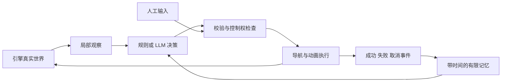

# 小庭院仿真阶段：研究与执行计划

日期：2026-10-21。更新于 2026-10-23：S2 基础切片与[转身/停步/脚部接触候选](sim/S2_CONTACT_PASS.md)已交付。Godot 4.7.2 中现成动作、池边目标跟随与纸船因果交互通过检查；已修正运行时泛白，完整画质与用户自然度验收未完成，AI 尚未实现。下面保留阶段设计，S0 调研实施状态以本更新为准。

## 已确认方向与本轮边界

用户认可“观察、干预、接管”的小世界构想，要求先收束既有成果、保存 GitHub，再搜索新阶段方案。当前任务完成归档和研究，不把研究结论称为功能已实现，也不把三个模式同时做成大平台。

体验目标：用户改变一件小事，角色基于自己的观察行动，行动改变真实场景；用户可以随时接管身体，放手后角色继续。保持庭院的安静气质，不要求聊天。

原成果见 [B2 收束](archive/B2_CLOSEOUT.md)。归档提交 `68f43df9c46059abc4b29be9b74c532548f9a1b7`，标签 `courtyard-b2-archive-2026-10-21`。Blender 仍是美术源，旧浏览器 C2 是实现参考。新实时工程与原 `.blend` 分离，不重建覆盖原作。

## 运行时判断

| 路线 | 可用能力与代价 | 本项目取舍 |
| --- | --- | --- |
| Godot 4 稳定版 | 场景、角色控制、碰撞、导航、动画状态和相机可在同一运行时组织。需要新工程及材质迁移。 | S1 已采用 4.7.2 stable / MIT，具体安装与验证见交付记录。 |
| 现有 Three.js + three-vrm | 已有浏览器预览和角色控制经验；要额外组合导航、碰撞、物品状态和接管机制。 | Godot 迁移若代价过高，作为保留的备选；不同时做两套产品。 |
| Unity + UniVRM | VRM 与导航能力可用，但目前没有 Unity 工程存量。 | 仅当 S1 暴露明确的角色或动画缺口，再评估；当前不迁移。 |

这是针对当前规模的工程推荐，不是通用引擎性能排名。暂不锁定发布平台；先在当前 Mac 运行。先验证一小块场景，不把整个 Blender 场景一键导入成功等同于画质迁移成功。

## 一手资料与可复用范围

调研由主代理和用户指定的 GPT-6.1 Sol / high 子代理完成；只读浏览，未安装插件、下载动作包或运行付费模型。

| 来源 | 可采用的方法 | 限制与许可 |
| --- | --- | --- |
| [Godot 3D 导入](https://docs.godotengine.org/en/stable/tutorials/assets_pipeline/importing_3d_scenes/available_formats.html) / [导入配置](https://docs.godotengine.org/en/stable/tutorials/assets_pipeline/importing_3d_scenes/import_configuration.html) | 从 Blender 导出 GLB，分离场景、人物和动作；保留资产与运行脚本分层。 | `.blend` 直接导入也经 Blender/glTF 转换。程序材质、光照链接、合成和离线渲染不能保证原样；需烘焙或实时材质替代。 |
| [Godot NavigationAgent](https://docs.godotengine.org/en/stable/tutorials/navigation/navigation_using_navigationagents.html) / [AnimationTree](https://docs.godotengine.org/en/stable/tutorials/animation/animation_tree.html) | 导航查询、角色移动和动作混合分开。 | 导航节点不直接移动角色；仍需运动控制和失败反馈。[引擎 MIT](https://github.com/godotengine/godot)。 |
| [Godot humanoid retarget](https://godotengine.org/article/animation-retargeting-in-godot-4-0/) | 复用现成人形动作，映射原少女骨架。 | 仍要核验 Rest Pose、骨向、脚滑、衣服穿插与接触；不是“58 骨骼所以自动适配”。 |
| [godot-vrm](https://github.com/V-Sekai/godot-vrm) | VRM/MToon 支持和人形映射可作为后续补充。 | MIT 代码；样例资产独立许可。README 有 VRMC_vrm_animation 未实现和约束重定向问题；先尝试普通蒙皮 GLB，不把此插件作为前置。 |
| [UniVRM](https://github.com/vrm-c/UniVRM) / [three-vrm](https://github.com/pixiv/three-vrm) | 其他运行时的角色加载路径。 | MIT 代码，不提供完整生活模拟；素材许可独立。 |
| [Quaternius Universal Animation Library](https://quaternius.com/packs/universalanimationlibrary.html) / [作者更新记录](https://quaternius.itch.io/universal-animation-library/devlog/1555893/added-root-motion-and-other-fixes) | 寻找待机、走路及交互动作，再重定向至现有角色。 | CC0 候选；免费 Standard 是部分内容，不能把整套 120+ 动作都视为免费包已有。下载时核实具体动作、版本和包内许可。未下载或集成。 |
| [Generative Agents](https://github.com/joonspk-research/generative_agents) | 借鉴观察、记忆、计划的分层。 | Apache-2.0 代码；原地图、模拟器和旧模型调用不直接搬用。先用有限事件记忆，暂不做多角色社会和周期反思。 |
| [Voyager](https://github.com/MineDojo/Voyager) | 借鉴技能执行、环境反馈与修正的循环。 | MIT 代码，原实现依赖 Minecraft 环境；本项目采用预定义技能，不接自动生成代码执行。 |
| [SIMA 2](https://deepmind.google/blog/sima-2-an-agent-that-plays-reasons-and-learns-with-you-in-virtual-3d-worlds/) | 第一视角观察与行动的长期研究参考。 | 未核实到本项目可直接使用的公开 SDK/权重，不能列作实现依赖。 |

## 需要实现的六块能力

1. **世界状态**：物品 ID、位置、可操作范围、阻挡关系、纸船漂浮/卡住状态，由引擎持有。第一版沿简化水路移动，不做流体模拟。
2. **身体和技能**：`look_at / move_to / interact / wait`。坐姿短片只提供既有表演参考；走路、转身、起身和交互需要可播放的动作。每次动作以实际位置/物品状态判定结果。
3. **观察**：视锥、距离、遮挡筛选物体，独立记录听觉事件。导演可以看全场，角色不能知道视野外被移动的物体。结构化局部观察不称作纯像素视觉智能。
4. **控制交接**：唯一控制权 `AI / HUMAN / PAUSED`。人工接管立即中断导航和动作；控制世代号递增，过期模型回复丢弃。放手后重新观察。第一视角检查头部遮挡、相机穿墙和朝向，不只是把镜头放入头骨。
5. **决策和记忆**：先规则策略，再以同一接口接 LLM。模型选目标/技能，不控制每帧骨骼；事件记忆保留时间，区分“曾看到”与“当前看到”。不要求模型微调、RL 或向量数据库。
6. **记录与恢复**：保存初始状态、干预事件、动作结果、控制权变化、模型耗时和调用量。支持重置相同情境，比较规则与 LLM 行为。调试信息独立于正常体验画面。

动作携带 `action_id / observation_id / control_epoch / target_id`；执行器校验目标仍存在、可达、在交互距离内。结果为 `succeeded / failed / cancelled`，包含 `path_blocked / out_of_reach / target_missing` 等事实原因。旧观察触发的动作必须再次校验，模型文字不直接写入世界事实。

LLM 只在新相关事件或动作结束时决策；等待与连续运动由引擎推进。第一轮建议每局上限 20 次请求、每次输出上限 256 tokens、一次失败最多重试一次；这些是原型预算参数，不是实际已发生的调用。超时使用等待/规则后备，世界继续运行。模型供应商、授权和费用上限在 S4 接入时落实，密钥只在本地决策服务环境中。

## 第一个完整切片：纸船卡住了

纸船沿水路漂到石头旁停住；角色看到后靠近并观察。玩家可以移走可移动的小阻挡，也可以接管角色，走到接触范围执行释放纸船的动作；退出接管后，AI 根据新的观察继续，不重复处理已解决事件。

先用明确交互锚点和短动作实现可信的接触；精细手指抓取不是前置。若现成动作无法产生可接受接触，优先缩小为“靠近、观察、玩家解除阻挡、角色继续”，明确降低交互范围，不用远距离修改状态冒充伸手成功。

| 阶段 | 可见交付 | 通过条件/停止线 |
| --- | --- | --- |
| S0 归档与研究（完成） | GitHub 归档标签、私人快照与本计划 | 清单可恢复，明确现有/未实现边界。 |
| **S1 资产与控制验证（技术完成）** | 小型 Godot 工程：一段池边、少女A、已有动作、观察/第一视角切换 | 蒙皮/尺度/贴图无明显损坏，手动控制与相机可用；新GLB与原文件分离。迁移不成立则定位一次主要问题，再比较 Three.js 路线。 |
| **S2 身体与世界（基础切片完成，品质待验收）** | 角色可走到池边；纸船真实卡住/释放；规则行为可重置 | 路径失败有结果、脚底不明显滑动、不穿过池壁；阻挡移开后船继续。先落实现成动作来源。 |
| S3 控制与可观测性 | 人工随时接管/释放；事件回放 | 延迟 AI 回复不能夺回控制；视野外物体变化不泄露；失去目标后不追踪不存在的位置。 |
| S4 LLM 最小接入 | 同一世界、同一动作协议替换规则策略 | 至少两种干预有因果对应的行动；模型超时/无效目标/预算耗尽仍能运行。比较是否比规则基线更有趣。 |
| S5 体验决定 | 一次可玩的短体验及用户反馈 | 用户是否愿意再次改变条件看她反应；若仅技术成立、体验无增益，收束到规则互动或暂停。 |

S1 不以重现 Cycles 画质为门槛；记录对照差异，在交互成立后再修实时光色。不得把“先降低验证门槛”变成永久接受低画质。每阶段先交付，再决定是否扩大，不预设多人、开放世界、完整物理、聊天或 exploreBrain 训练。

## S0 研究时的结果与未验证事项（历史）

- 已完成：旧公开成果归档推送；私人快照 16 文件逐项 SHA-256 检查；原浏览器 5 项测试与构建通过；Blender Python 脚本语法解析通过。
- 原浏览器构建存在大于 500 kB 的 chunk 提示，未在收束阶段重构。
- 尚未验证：Godot 本机兼容性、GLB 实时画质、行走/交互重定向、真实 LLM 延迟/成本、玩家体验。
- 尚未实施：新运行时安装、素材下载、真实模型调用、行为学习。
