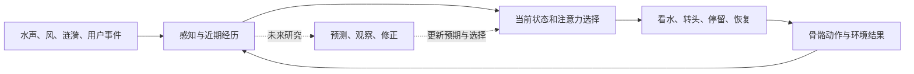

# 果蝇研究对庭院人物行为的启发

调研日期：2026-09-14。用户优先要求把整体场景做活，接受少女 A 暂无面部数据。本文件是行为方向研究，不安装果蝇模拟器、不接入 exploreBrain，也不开始训练。

## 最近发生了什么

1. **2026-09-03 的新连接图**：Google Research 与 HHMI Janelia 等发布雄性果蝇完整中枢神经系统连接图，包含脑、视叶与腹神经索，超过 166,000 个神经元、约 1.25 亿突触连接。它提供结构数据，并非直接可用的、具有完整学习能力的人物大脑。[Google 原文](https://research.google/blog/a-connectomics-milestone-mapping-the-complete-male-fruit-fly-brain/)、[Janelia 数据入口](https://www.janelia.org/project-team/flyem/male-cns-connectome)。
2. **2026-03-10 Eon 对具身果蝇演示的解释**：把连接组约束神经模型与 NeuroMechFly 身体接起来；少量下行信号控制运动，动作依赖已有模仿学习控制器，部分输入输出映射由人工选择。作者明确说内部状态、可塑性与学习大多缺失，视觉输入在当时尚未显著影响行为输出。因此不能把演示解释为“仅复制连接图，就自动获得完整动物智能”。这与九月的新数据发布是不同工作。[Eon 技术说明](https://eon.systems/updates/embodied-brain-emulation)。
3. **身体平台独立于大脑**：NeuroMechFly v2 用于感觉—运动—环境闭环；另一个 flybody 项目提供 MuJoCo 身体及运动强化学习任务。两者不是同一个项目，也不是直接供 Blender 人物使用的动作插件。[NeuroMechFly 论文](https://www.nature.com/articles/s41592-024-02497-y)、[flybody 官方仓库](https://github.com/TuragaLab/flybody)。
4. **行为逼真不等于神经机制被复现**：《The digital sphinx》作者公开稿把线虫连接组与果蝇身体、训练出的运动解码器组合，也能得到逼真步行。它说明需要分开检验行为效果和模型机制。本轮未核实该稿的最终同行评审状态。[作者公开稿](https://faculty.washington.edu/tuthill/docs/TheSphinx_2026.pdf)。

近期让神经模拟玩游戏的社区视频可以作为灵感，不能单凭视频推出学习有效或意识存在。本轮没有审计这些演示的代码，不据此做性能结论。

## 对本项目的设计推论

以下是我们的工程取舍，不能说成论文直接证明了这些人物设计。

最值得采用的是一个持续闭环：

| 可借鉴原则 | 庭院中的具体表现 | 当前是否需要学习 |
| --- | --- | --- |
| 身体与环境形成反馈 | 转向水池后继续关注落点，事件结束才慢慢恢复 | 不需要，先做可控动作与状态 |
| 状态有持续性 | 她刚被打断时，不会下一瞬间再次全幅转头 | 不需要，用衰减与恢复规则 |
| 行为之间存在竞争 | 风声、涟漪同时发生，注意力选一处而不来回抽动 | 不需要，设置优先级和切换迟滞 |
| 控制分层 | 上层决定“看哪里、看多久”，下层保证平滑、支撑稳定 | 不需要先训练关节控制 |
| 动作有后果 | 将来可学习哪些线索预示接下来的环境变化 | 需要可观测反馈和受控对照，留未来 |

不能把“每次点击随机播放不同动作”称作智能，也不能把人工设置的刺激衰减称作已经实现的强化学习。角色暂时没有眼睑与眼球控制时，可先通过头部朝向、肩背、手的停顿和动作时序表达注意力。

## 与 exploreBrain 的关系

本轮只读核对了 `/Users/fengzhuo/Documents/exploreBrain/readme.md`：其主线仍是预测—观察—修正，M4b 未完成，不能当作现成完整智能引擎。

两条方向可互补：庭院给出可感知、可行动、有结果的小世界，exploreBrain 将来研究怎样学习预期并更新行为选择。接口应是有限的行为意图与观测结果，而不是让学习器直接写几百个骨骼角度。

未来最小实验可以是“一个环境线索预示另一处事件”，在同一套动作执行层上比较固定规则、带短期状态、带预测学习三种控制器；改变线索位置/可靠度后，检查是否更新预期、错误反应是否减少。使用留出的变化情境与相同观测/动作预算，记录学习增益，而不只看演示是否好看。用户点击是观测事件，不自动当奖励；连续点击也不应被优化为产品目标。

## 当前制作顺序

- 少女 A 用现有身体骨架入景，接受静态脸；不再为面部数据寻找素材或重绑而停工。
- B1 保留完整庭院和相机，先检查坐姿、人物尺度、遮挡和水边接触。
- 静态摆放评审后，B2 原生短片优先表现水面、树叶与身体细微动作的共同节奏。一处变化引出一次有限回应，其余时间保持安静。
- 不增加聊天、神经网络训练或果蝇脑依赖。场景感受与未来智能研究分开验收。
