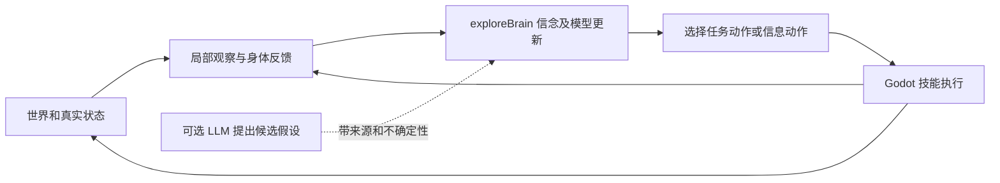

# 从角色演示到持续学习：exploreBrain 结合研究

日期：2026-10-26。性质：方向评估与实验设计建议；尚未选定或实现整合方案。

用户认为继续美化单机/demo 缺乏意义，提出结合 exploreBrain，并要求参考顶尖研究深入思考。本轮只读检查两个项目，核对一手论文、研究项目和已有实验记录。没有重跑 exploreBrain 实验、修改其文件、启动训练、安装依赖或接入收费服务。

## 1. 先明确“不是空壳”的可检验含义

视觉可信、行为因果成立、能从经验学习、具备主观体验，是不同问题。前两项不能推出后两项；学习成立也不能证明意识、感情或人格。若期望是“真实主观生命”，这里没有可承诺的实现路线。

能够研究的目标是：经历改变了系统的预测与决策；变化在新情境中有用；旧经验失效时会被修正；这些效应可以通过关闭学习、替换记忆和控制观察等方式验证。世界可以人为设计，学习规则也可以人为编写；需要避免的是把正确答案和针对测试情境的反应直接写入 agent，然后宣称是它学会的。

这使当前方向有机会转为一个持续学习研究项目。做成商业游戏不再是唯一交付尺度，但研究问题也必须成立，不能只给原 demo 换一个名称。

## 2. exploreBrain 的真实起点

本轮核对位置（均为当前本机文件，未重新运行实验）：

- `/Users/fengzhuo/Documents/exploreBrain/readme.md`
- `experiments/12.17_online_model_repair/README.md` 的 12.17d 结果与边界
- `experiments/12.18_partial_model_creation/README.md` 的失败记录和终止规则
- `experiments/12.19_structure_information_actions/README.md` 与 `output/exp12.19a_results.json`
- `src/joint_belief.py` 的 `PairDependencyModelCreator`
- `src/sequential_voi.py` 的 `JointConstrainedSequentialVOIPlanner`

已存记录支持 M1–M3 和 M4a 的受控结果；尚未形成统一长期运行 agent，M4b 未完成，M5 抽象与自主目标未突破。不能把这些记录表述成本轮复现通过。

最相关的三个发现：

1. 12.18 的未知依赖创建在长时域有部分行为收益，但最终结构正确率和若干相对改进门槛没有通过。更换 detector、延长时域、增加普通 probe 已不是默认下一步。
2. 12.19a 把缺口定位到观察通道：在该生成器保持边际不变的条件下，单 gate 及错误 pair 对目标依赖的信息量约为零。存档结果中，自然反馈平均 KL 为 0.00878，完整反馈为 0.0600；在所用阈值/成本协议下，平均诊断的信息预算可能超过短时行为收益。这些数字仅适用于该受控协议。
3. 下一步 12.19b 是让 agent 选择更有信息的试验条件，而非被动积累更多相同反馈。高信息条件是协议分析发现的机会，不等于 agent 已学会找到它们。

源码边界尤其重要：当前 creator 默认在三条预定义 edge 和离散 eta 候选中选择/更新。它能学习这个假设族内的结构，不能据此宣称自动发明任意概念或因果模型。联合 belief planner 也面向有限 gate/outcome；并非直接可控制 Godot 任意场景的通用大脑。

因此，结合机会是让“行动怎样改变可得证据”成为可测试对象；不是把 exploreBrain 当前模块插到少女模型上就获得完整智能。

## 3. 顶尖研究对路线的实际约束

检索截至 2026-10-26。以下区分论文结果、观点文章和我们的推论，不以模型热度排序。

| 研究 | 已报告的核心工作与边界 | 对本项目的取舍 |
| --- | --- | --- |
| **DreamerV3，Nature 2025** | 学习环境模型，在想象轨迹中训练行动策略；同一算法配置在多任务上有效，不等于一个智能体已终身掌握所有任务 | 借“预测必须服务行动”的闭环；不要把完整像素世界模型训练设为接入前提 |
| **V-JEPA 2，2025；2.1，2026** | 2 结合大规模视频预训练和动作条件后训练实现机器人规划；2.1 改进稠密时空表征。视觉表征、规划与持续在线学习仍是不同能力 | 可以研究预训练感知复用，但不是现成的个人角色大脑；2 的“少于 62 小时机器人视频”前面还有百万小时量级互联网视频预训练 |
| **HUME，RSS 2026** | 用基础模型提出不确定假设，再规划行动验证并更新世界模型；假定可靠原子技能、可表达/可验证的目标及有能力提出正确假设的语言模型 | 与当前缺口最接近。借鉴“假设可撤回，行动获取证据”；不能包装成不依赖先验的自主概念诞生 |
| **主动感知 AAWR，NeurIPS 2025** | 学习主动获取缺失信息的行为；训练时使用额外特权传感器估计价值，并用少量示范与初始策略启动 | 具身价值可能来自看哪里、移动到哪里才看得清。特权信息必须与运行时输入分开，不能直接拿全局状态充当感知 |
| **SIMA 2，2025 技术报告** | Gemini 基础模型、具身训练、任务生成和奖励模型组成系统；收集自生成经历后通过训练改善新环境能力 | 说明“虚拟世界可以承载学习研究”；自我改进含实际训练，不是给普通 LLM 加一段反思提示就能等价复现 |
| **持续可塑性，Nature 2024 / 作者预印本** | 测试中神经网络长期学习不仅会遗忘，也可能逐渐失去学习新任务的能力 | 测试多次变化和旧规律回归，不能只演示一次 A→B 适应；不预先给现有小型 Bayesian 模型套神经网络修复算法 |
| **Silver/Sutton《Era of Experience》，2025** | 倡议持续经验流、环境反馈和长期后果，是研究方向文章，并非通用持续 agent 已被实现的证据 | 解释长期目标；不能据此承诺个人可从零复现通用智能 |
| **Oudeyer 好奇心与发展学习研究，2018 综述** | 讨论学习进展、探索与自组织课程等机制；不同内在动机定义有不同适用条件 | 后续研究自主选择练什么；当前先证明有成本的信息获取，不能把预测误差大直接当值得探索 |

一手来源与本轮阅读范围：

1. [DreamerV3 正式论文](https://www.nature.com/articles/s41586-025-08744-2) / [作者预印本](https://arxiv.org/abs/2301.04104)。Nature 全文访问受限，本轮核对官方索引摘要和作者预印本摘要，不声称完成全文复核。
2. [V-JEPA 2](https://arxiv.org/abs/2506.09985) / [V-JEPA 2.1，v3 更新于 2026-06-11](https://arxiv.org/abs/2603.14482)。本轮核对作者摘要与版本，未审计训练代码、权重或本机资源。
3. [HUME 项目](https://open-world-planning.github.io/) / [论文全文](https://arxiv.org/html/2607.06501v1)。重点核对假设生成、验证、IV-F Necessary Assumptions 和讨论；RSS 2026 归属由作者项目页标注。
4. [主动感知 AAWR](https://papers.nips.cc/paper_files/paper/2025/hash/aa1b1a959c80086cba61d0fd66de412f-Abstract-Conference.html)。核对会议官方摘要。
5. [SIMA 2 全文](https://arxiv.org/html/2512.04797v1)。重点核对 §4.5：任务生成、奖励打分、经历数据与后续训练，不把有限试验称作无限自我提升的证明。
6. [持续可塑性正式论文](https://www.nature.com/articles/s41586-024-07711-7) / [作者预印本](https://arxiv.org/abs/2306.13812)。正式全文访问受限，预印本与正式版的指标不可混用。
7. [Era of Experience 原文](https://storage.googleapis.com/deepmind-media/Era-of-Experience%20/The%20Era%20of%20Experience%20Paper.pdf)。核对持续流、动作/观察、环境后果三部分；不把作者预测当已经实现的事实。
8. [Computational Theories of Curiosity-Driven Learning](https://arxiv.org/abs/1802.10546)。历史概念参考，不是 2026 新成果。

这些工作已经覆盖大量相邻问题。我们不能声称“首次让角色主动验证假设”。合理的个人研究价值首先是严谨复现与找出边界；原创性需要进一步比较实验设定和方法，而不是由名称或场景风格决定。

## 4. 建议聚焦的问题

> 在环境规律会变化、观察有代价的条件下，agent 能否根据自己当前的不确定性，选择有区分力的试验，修正可复用的世界模型，并在扣除试验成本后改善后续决策？

这个问题包含四个可单独失败的环节：发现认识可能有误；选择能区分解释的证据；根据结果修正；修正产生净行为收益。它与 exploreBrain 的 12.19b 直接相连。

庭院设想只用来帮助理解：某处水路不再通畅，她可以直接尝试通过、换位置观察、测试一个可操作构件，或走更贵但可靠的路线。随着经验增加，她选择检查的位置/方式发生变化；换布局或改变机制后，要检查是否迁移、是否坚持错误经验。此情境尚未实现，不代表现有纸船已经有这些物理与感知能力。

需要区别：改变观察位置、选择实验 context，能增加辨识信息，但不自动等于获得因果结论。若要研究因果，应允许受控干预并与观察数据区分；仅检测 gate 相关性应继续称为依赖学习。

## 5. 两个项目怎样连接才有必要

- **世界/身体**：保留 Godot 控制、碰撞与接管；底层走路和骨骼不必从零学习。这属于研究假设的范围限制，应明确披露。
- **学习主体**：复用 exploreBrain 的 belief 更新、任务条件信息价值、部分反馈 likelihood、模型竞争和实验记录；环境对象和任务接口需要适配，不能仅改几个类名。
- **可选 LLM**：提出候选解释或组合已支持的技能；它的先验与在线学习收益分别评估。第一轮可不用 LLM，保留“不依赖冻结 LLM 作为核心”的原研究目标。
- **展示**：少女和庭院能让观察、犹豫、验证与纠错可见；不能用生成的内心独白冒充机制证据。

Godot 值得接入的条件是：视角、遮挡、路径和行动耗时确实改变可获得的证据与决策成本。若它只播放 Python 已决定的路线，就是展示层，不构成额外研究成果。

学习层只接收可获得的观察、动作结果和时间/成本；不得读取场景树中的隐藏结构、真值坐标或环境身份。调试记录可以持有真值，但需要单独通道。人工接管取消当前动作并使迟到结果失效；下一次决策从新的观察继续。

目前不建议直接合并仓库。先明确协议和学习模块边界；正式修改 exploreBrain 时遵循其 AGENTS.md：实验计划/数据进入对应实验 README，log.md 只记核心原理；当前文档不是代替那份预注册。

## 6. 能区分真实增益与表演的验证

先延续已有 12.19b 的问题，补完其预注册和信息边界，再判断是否需要身体环境。不要为了结合项目更改已有失败结论或降低门槛。

必须有的对照：相同身体/观察预算下的冻结模型、被动学习、随机或当前条件诊断、主动选择信息试验；Oracle 仅作评估上界。LLM 如加入，比较同一基础模型下有/无在线更新，防止把预训练知识算成此次经历学到的。

必须记录：未见条件上的预测质量、正确模型/错误高置信模型比例、试验后的净成本、变化检测与适应延迟、旧规律回归的保留能力、观测/推理时间、实际执行失败。一次演示成功或人物说“学会了”不构成通过。

三个特别需要审计的问题：

1. **Oracle 泄露**：12.19b 草案提到剩余 Oracle headroom。若用它决定在线何时试验，必须说明该量是否能从 agent 自身 belief 得到；真实 Oracle 只能留在离线协议审计/评估，不能隐蔽送入策略。
2. **候选选择偏置**：12.19a 的高信息 context 列表是针对真实 edge 审计得到的。运行时应按自身候选在全部允许 contexts 上评分，不能直接把那 12 个带真值优势的条件喂给 agent，也不能写死真实 edge。
3. **历史效应归因**：使用独立测试流，冻结学习参数后比较；增加去掉已学结构/错配记忆的消融。持续状态改变行为本身还不够，必须改善未见试验的预测或成本。记忆失配使表现下降，也不能单独证明抽象或人格。

当前 gate 实验中用有限概率模型即可研究上述机制；不必先训练大型视觉模型。具体 CPU 时间、Godot 同步吞吐和整体成本尚未测量，不能预估为“很快就能做完”。长期泛化更需要多种变化和结构外测试；超出假设族时应允许拒绝自信预测，而非强行选一个现有模型。

## 7. 投入判断

目前不建议继续投入：新增生活剧情与家具、训练全身运动、从零复现大型 JEPA/Dreamer/SIMA、果蝇连接组替代整个人物大脑。这些都没有直接解除当前的证据获取瓶颈。

值得研究的近期产出是一个明确结论：在相同反馈与成本约束下，主动选择试验是否真正优于“多看一些/多记一些”。成功或失败都能推进 exploreBrain 的问题；只有这个闭环成立，再考虑角色如何将它表达出来。

如果用户主要期待的是个体情感、主观意识或无需设计目标就能形成完整自我，现有证据不能承诺达到。若用户愿意探索一个会更新认识、选择验证行动并累积有限能力的系统，两个项目存在实质结合点。该建议待讨论，不因本轮调研自动启动整合或训练。
