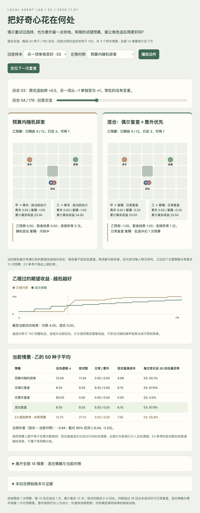

# E4 进展与结果

2026-11-01。状态：**实现、批量实验、全量复算与浏览器操作检查完成；用户体验评价待反馈。** [冻结计划](PLAN.md) / [代码与重现命令](../../../../experiments/budgeted_agents/README.md) / [本地回放](http://127.0.0.1:4190/e4-v1/replay.html)。回放 HTML 内嵌数据，也可离线打开。

## 本轮实现

偶尔复查和意外触发共用预算，意外优先；日常复查为可能出现的意外保留一次已释放额度。每角色初始释放 1 次、每 15 回合追加 1 次、最多 12 次，尝试之间至少 6 回合。超过 18 回合未亲历的旧选项才进入日常复查候选。意外仍要求个人预测出现连续两次足够大的偏差，次回合提出请求，不读世界变化时间。预算按实际执行扣除；被拒绝的请求及原因进入日志。

对照为预算内随机、仅偶尔、仅意外、混合，另列不受统一预算约束的 E3 原规则。四个主策略上限一致，实际花费不强制相等；初始两个未知选项各尝试一次单列。随机选择即使碰巧与当前优选相同也扣预算。角色有独立个人价值与信任；共享策略、消息交换和寻路是预定规则，未训练神经网络、未调用语言模型。

## 固定实验与计分

14 情景 × 5 策略 × 50 配对种子 × 180 回合 × 2 角色，共 **3,500 组、1,260,000 次选择**。变化起点分别为 27、53、91；包含稳定、稳定加噪、同时互换、另一项单独变好、两项先后变差及先后变差加噪。非同步变化间隔 23 回合，期间不重置记忆。情景/参数/3 个回放样本在批量运行前固定，源码与配置指纹见 [manifest](../../../../experiments/budgeted_agents/results/e4-v1/manifest.json)。

主要指标为乙累计错过的期望收益（动态伪遗憾，越小越好），噪声按其真实期望计分，不把随机结果当作可预知答案。每次变化另计后 20 回合最优选择率及连续 5 次最优的恢复时间；恢复窗口截止下一次变化或实验结束，未恢复单列，不当成零。甲保留完整指标，不将两角色或同一轮当作独立样本。

## 结果与取舍

下表为乙的 14 情景等权描述性均值，不代表真实世界的场景分布，也没有给总体收益做泛化保证。

| 策略 | 预算探索/角色 | 总损失 ↓ | 探索当次直接损失 ↓ |
| --- | ---: | ---: | ---: |
| 预算内随机 | 11.34 | 16.78 | 6.25 |
| 仅偶尔复查 | 8.01 | 15.84 | 8.71 |
| 仅意外复查 | 0.49 | 18.39 | 0.37 |
| 混合复查 | 8.12 | 14.93 | 8.87 |
| E3 非等预算参考 | 21.39 | 17.26 | 11.62 |

混合相对预算内随机，尝试减少约 **28%**、总损失降低约 **11%**。但它探索当次的直接损失更高：定向复查常选已知较差选项，而随机有时仍选优选。收益来自少数情景中更早发现变化，不能把“次数更少”直接等同于“每次更划算”。

- **补上意外检测的盲点**：另一项在第 53 回合悄悄变好，混合与仅偶尔复查的总损失均为 8.50，随机为 12.44，仅意外为 65.00。仅意外在三个隐蔽改善时刻均 50/50 未恢复：常吃的没有变差，就没有异常来触发。混合相对随机的配对损失差为 −3.94，95% bootstrap 区间 [−6.04, −2.20]。
- **两种机制结合并非普遍优于单一机制**：相对仅偶尔复查，混合的净优势主要集中在 `swap@27`（38 → 24）；许多其他情景相同，加噪情景有轻微额外损失。当前额度释放和保留规则的时机影响很大。
- **稳定时额外好奇心会付费**：稳定世界混合损失 20，随机 13.44；稳定加噪混合 18.784，随机 13.088。保留额度没有消除误触发。种子 100 的稳定加噪回放第 66 回合可看到意外复查又吃到 −1。
- **先后变化没有稳定增益**：无噪声非同步情景中，原有持续价值更新已能改换选择，混合反而多付复查成本；加噪非同步的三组配对区间均跨 0。第 91 回合同时互换的区间也跨 0，不能只展示较早变化的优势。

完整总损失（乙，50 种子均值）：

| 情景 | 预算内随机 | 仅偶尔 | 仅意外 | 混合 | E3 非等预算参考 |
| --- | ---: | ---: | ---: | ---: | ---: |
| stable | 13.440 | 20.000 | 2.000 | 20.000 | 23.600 |
| noisy_stable | 13.088 | 18.016 | 7.424 | 18.784 | 24.320 |
| swap@27 | 41.440 | 38.000 | 6.000 | 24.000 | 26.920 |
| swap@53 | 36.600 | 22.000 | 6.000 | 22.000 | 27.280 |
| swap@91 | 35.960 | 31.320 | 6.000 | 31.320 | 27.320 |
| hidden_gain@27 | 12.490 | 11.500 | 78.000 | 11.500 | 12.840 |
| hidden_gain@53 | 12.440 | 8.500 | 65.000 | 8.500 | 13.700 |
| hidden_gain@91 | 13.110 | 13.160 | 46.000 | 13.160 | 16.210 |
| staggered@27 | 5.685 | 6.250 | 3.500 | 6.250 | 7.475 |
| staggered@53 | 6.620 | 7.250 | 3.500 | 7.250 | 8.830 |
| staggered@91 | 7.850 | 10.395 | 3.500 | 10.395 | 11.345 |
| noisy_staggered@27 | 8.152 | 8.024 | 6.108 | 8.056 | 9.632 |
| noisy_staggered@53 | 11.732 | 11.468 | 9.512 | 11.656 | 13.332 |
| noisy_staggered@91 | 16.332 | 15.832 | 14.884 | 16.180 | 18.852 |

逐情景的配对差使用固定种子 bootstrap 2,000 次，未作多重比较校正；完整区间与每次变化指标见 [summary.json](../../../../experiments/budgeted_agents/results/e4-v1/summary.json)。E3 同时保留常规随机与额外复查，平均 21.39 次；不能与上限 12 次的主策略混称等预算对照。

## 验证与可见结果

- 14 项测试通过：额度释放、冷却、保留额度、优先级、未知选项、请求过期、个人证据边界、跨进程恢复、E3 原规则一致性、异步变化与截断、损坏日志拒绝等。见 [测试日志](../../../../experiments/budgeted_agents/results/e4-v1/review/unit-tests.txt)。
- [独立审计与全量复算](../../../../experiments/budgeted_agents/results/e4-v1/verification.json)通过：重算全部 3,500 组/126 万次选择；另逐条核对 15 段完整轨迹、48,600 次物理动作及预算、预测误差、延迟请求、世界时序/噪声、消息和最终存档。
- 回放逻辑检查覆盖 12 个样本/对照组合、8,640 张角色状态卡和 14 情景汇总行；此为 DOM 替身检查，单独记录，不冒充浏览器测试。
- 实际浏览器检查：播放/暂停、回合拖动、定位复查、三种回放样本、随机/E3 对照切换、完整情景表展开/收起；确认第 54 回合随机请求因冷却被拒而混合日常复查获批，及第 91/114 回合先后变化和 E3 非等预算标识。见 [浏览器记录](../../../../experiments/budgeted_agents/results/e4-v1/review/browser-verification.json)。截图已目视检查，未将其视为用户主观验收或帧率测试。
- 批量生成耗时约 116.27 秒，复算另计；没有新增依赖、模型调用、资产下载或收费服务。它是小型结构化模拟的运行时间，不能外推大量 LLM NPC 的性能。

## 目录与延续

源码/测试/协议/原始摘要与轨迹/审阅证据分别位于 `src/`、`tests/`、`protocols/`、`results/e4-v1/raw/`、`results/e4-v1/review/`。E1–E3 的 162 个非缓存文件指纹保持一致；旧结果未覆盖。新结果留在本地项目，**本轮未提交或推送 GitHub**。原 Godot、Blender 与 exploreBrain 未改。

目前仍是有成本取证、经验更新和评估回放的实验性 agent harness 组件；触发规则由人设计，不能据此声称角色已学会发明策略、产生人格或形成通用智能。

下一轮候选问题是：**稳定一段时间后，能否自动降低无效复查频率，同时保留发现隐蔽改善的机会？** 应同时比较简单固定间隔，衡量信息收益而非继续叠规则；保留当前 14 情景作回归并另设未调参的变化时刻。仅记录建议，E5 尚未实现。
