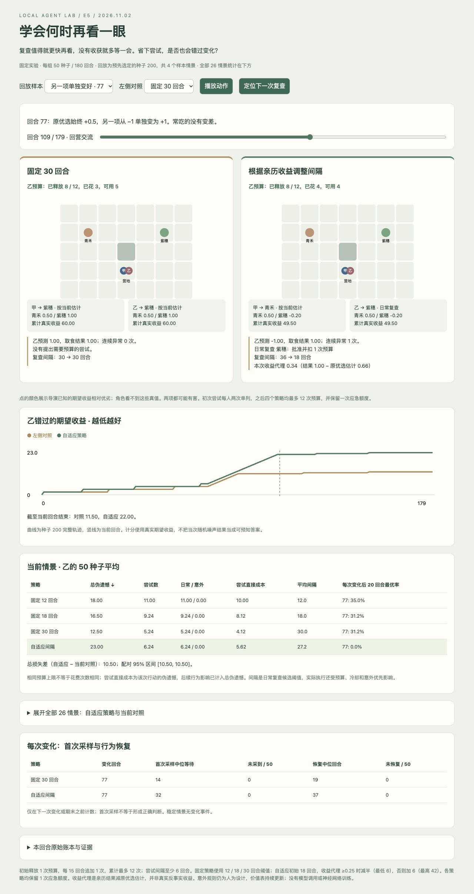

# E5 进展与结果

2026-11-02。**实现、批量对照、全量复算及浏览器检查完成；自适应规则未证实优于预定的固定 30 回合对照，用户体验评价待反馈。**

[固定计划](PLAN.md) · [源码/重现步骤](../../../../experiments/frequency_agents/README.md) · [打开本地回放](http://127.0.0.1:4191/e5-v1/replay.html)

## 实现了什么

两角色各自维护复查间隔，初始 18。实际执行日常或意外复查后，以“本次亲历收益 − 决策前原优选的估计分数”评估收益代理：≥0.25 时减半，最低 6；否则加 6，最高 42。下一回合生效。普通取食、未获预算的请求、单独收到消息均不直接改频率。

这不是观察到的反事实净收益：原优选分数包含个人估计及允许的近期消息加权，会出错。规则是人工设计的调度，不是训练模型权重或自主发明学习算法。所有四策略保留 E4 同样的意外优先、应急额度、冷却和个人价值更新，只改变日常候选间隔。固定 18 与 E4 hybrid 逐步行为对齐通过。

## 固定对照与完整结果

固定 12、18、30、自适应四策略；180 回合、种子 200–249。14 个旧情景加 12 个新时刻情景（41/77/119×四变化类型），共 **5,200 组、1,872,000 次角色选择**。旧时刻 27/53/91、非同步间隔 23、噪声、预算机制均保留。不按结果修改协议，样本回放在运行前固定为种子 200 的四个情景。

指标是乙累计错过的期望收益（动态伪遗憾，越低越好）；不把当次噪声结果当成可预知真值。总体为 26 情景等权描述性均值，不是实际世界分布。

| 策略 | 实际探索次数 | 总损失 ↓ | 平均候选间隔 |
| --- | ---: | ---: | ---: |
| 固定 12 回合 | 10.55 | 18.75 | 12.00 |
| 固定 18 回合 | 7.89 | 17.12 | 18.00 |
| 固定 30 回合 | 4.42 | 11.68 | 30.00 |
| 自适应间隔 | 5.21 | 15.77 | 28.44 |

相对主要对照固定 18，自适应探索次数少约 34%、总损失少约 8%；**固定 30 的总体损失和探索次数都更低**，所以不能仅挑固定 18 宣称自适应成功。固定 30 也只是本轮预定三档中的较好均值，不能称为普适最优。

按运行前分组分别报告：

| 检验组 | 策略 | 探索次数 | 总损失 ↓ |
| --- | --- | ---: | ---: |
| 14 旧情景 | 固定 12 回合 | 10.65 | 18.74 |
| 14 旧情景 | 固定 18 回合 | 8.09 | 14.89 |
| 14 旧情景 | 固定 30 回合 | 4.51 | 11.46 |
| 14 旧情景 | 自适应间隔 | 5.32 | 12.88 |
| 12 新时刻情景 | 固定 12 回合 | 10.44 | 18.77 |
| 12 新时刻情景 | 固定 18 回合 | 7.67 | 19.73 |
| 12 新时刻情景 | 固定 30 回合 | 4.32 | 11.94 |
| 12 新时刻情景 | 自适应间隔 | 5.08 | 19.14 |

新时刻中自适应损失 19.14、固定 30 为 11.94，自适应约高 60%。这直接限制了“稳定时少查、变化后及时发现”的结论。新时刻已经用于本轮评估，之后若据此调参，须再使用新的验证时刻，不能继续称同一组为未见数据。

## 成功、代价与具体失败

- **稳定时能少查**：自适应从 18 逐步延长到 42，平均 5 次复查、损失 12；固定 18 为 9 次、损失 20。固定 30 同样只需 5 次、损失 12。这说明退避实现有效，但复杂机制尚无独立优势。
- **能依据结果缩短间隔**：预定 `hidden_gain@77`、种子 200、乙第 109 回合亲历新收益 +1，原优选估计约 0.66，收益代理约 +0.34，使间隔 36 → 18；旧价值仍按 EMA 从 −1 更新为 −0.2，没有直接读取真值覆盖。
- **隐蔽改善仍可能发现很晚**：`hidden_gain@77` 首次亲自采到变化选项的中位等待为自适应 32 回合、固定 18/30 均 14；恢复中位为 37 对 19。自适应总损失 23，固定 30 为 12.5。第 119 回合隐蔽改善也出现自适应等待 32、固定 30 等待 2 的时间相位差。
- **意外触发存在历史门槛盲点**：`swap@77` 自适应损失 76、固定 30 为 16。事后只读诊断种子 200：乙在 77/78 回合误差为 2/1.2，但旧选项年龄仅 4/5，未达到 E3 的 8 回合门槛；到 79 回合误差降到 0.72，异常连续计数清零。即使已经看到坏结果，也要等长间隔重查。首次采样中位为 1，行为恢复却为 36；“采样到变化”不能冒充“已修正判断”。见 [诊断片段](../../../../experiments/frequency_agents/results/e5-v1/review/swap77-diagnostic.json)。未为改善分数修改触发规则。
- **非同步变化无需总是加查**：例如 `staggered@119` 两次变化后，自适应和固定 30 都能按原价值更新恢复，恢复中位均为 10/11；自适应损失 8.5，高于固定 30 的 7.25。
- **噪声仍会误导**：噪声稳定环境中自适应损失 13.536，固定 30 为 13.376；配对差 +0.16，95% 区间 [−0.416, 0.704]，不能宣称优于固定 30。可在第 111 回合看到无环境变化的意外复查及 36 → 42 的延长。

完整各情景总损失（乙，50 种子均值）：

| 情景 | 固定 12 | 固定 18 | 固定 30 | 自适应 |
| --- | ---: | ---: | ---: | ---: |
| stable | 24.000 | 20.000 | 12.000 | 12.000 |
| noisy_stable | 22.784 | 19.200 | 13.376 | 13.536 |
| swap@27 | 26.000 | 24.000 | 16.000 | 18.000 |
| swap@53 | 26.000 | 22.000 | 16.000 | 18.000 |
| swap@91 | 50.000 | 29.280 | 27.040 | 18.000 |
| hidden_gain@27 | 9.000 | 11.500 | 5.500 | 13.380 |
| hidden_gain@53 | 13.000 | 8.500 | 8.500 | 16.380 |
| hidden_gain@91 | 19.500 | 12.600 | 10.040 | 16.000 |
| staggered@27 | 7.500 | 6.250 | 4.250 | 5.500 |
| staggered@53 | 9.500 | 7.250 | 5.500 | 6.500 |
| staggered@91 | 12.500 | 10.320 | 7.180 | 7.500 |
| noisy_staggered@27 | 10.160 | 8.644 | 7.888 | 8.052 |
| noisy_staggered@53 | 13.688 | 12.044 | 11.332 | 11.348 |
| noisy_staggered@91 | 18.784 | 16.844 | 15.820 | 16.112 |
| swap@41 | 26.000 | 46.000 | 16.000 | 16.960 |
| swap@77 | 48.000 | 46.000 | 16.000 | 76.000 |
| swap@119 | 24.000 | 24.000 | 14.000 | 18.000 |
| hidden_gain@41 | 10.500 | 14.500 | 14.500 | 6.380 |
| hidden_gain@77 | 18.000 | 16.500 | 12.500 | 23.000 |
| hidden_gain@119 | 14.000 | 15.500 | 7.500 | 23.880 |
| staggered@41 | 8.500 | 7.250 | 5.500 | 5.370 |
| staggered@77 | 11.500 | 9.250 | 6.500 | 7.500 |
| staggered@119 | 13.250 | 11.250 | 7.250 | 8.500 |
| noisy_staggered@41 | 12.232 | 10.824 | 10.120 | 10.244 |
| noisy_staggered@77 | 16.520 | 14.816 | 13.964 | 14.040 |
| noisy_staggered@119 | 22.704 | 20.884 | 19.444 | 19.796 |

[summary.json](../../../../experiments/frequency_agents/results/e5-v1/summary.json) 保留双方指标、逐变化首次采样/恢复、未发现/未恢复计数和配对 bootstrap 95% 区间（2,000 次，未作多重比较校正）。首次采样及恢复截止下一变化或期末，不把未恢复计为零。某些无噪声情景的配对差完全相同，区间退化为点；这反映当前两选项世界与固定时间相位的确定性，不代表跨环境零不确定性。50 种子并不是 50 种独立世界结构。

## 验证与证据

- **12 项测试通过**：局部收益更新、阈值/上下界、拒绝/普通行动不更新、消息与角色隔离、触发反馈、固定 18 历史一致性、预算、跨进程 pending feedback 恢复、完整 episode 恢复、损坏收益/分数/预算审计拒绝。见 [日志](../../../../experiments/frequency_agents/results/e5-v1/review/unit-tests.txt)。
- [全量复算](../../../../experiments/frequency_agents/results/e5-v1/verification.json)通过全部 5,200 组/187.2 万次选择；**16 条完整轨迹、51,840 次物理动作**独立核对频率、原优选分数与信任、预算、个人反馈、世界时序/噪声、路径、消息和最终存档。恢复指标只是实验定义，不代表一般智能。
- [页面逻辑](../../../../experiments/frequency_agents/results/e5-v1/review/replay-logic-verification.json)：12 组合、8,640 张角色状态卡、26 情景表通过。DOM 替身与真实浏览器分开记录。
- [浏览器操作](../../../../experiments/frequency_agents/results/e5-v1/review/browser-verification.json)：播放/暂停、拖动、定位复查、四样本、三对照、全部情景展开/收起；稳定 19 回合间隔 18 → 24，隐蔽改善 109 回合 36 → 18，噪声 111 回合 36 → 42，非同步 119/142 分别计分。最终截图已目视检查，不声称帧率或用户主观验收。
- 页面页脚继承了旧固定间隔说明，浏览器检查时发现并仅修正文案；使用可重跑的 `scripts/finalize_replay.py` 记录页面前后散列。批次冻结模板、算法、协议、原始结果没有修改。见 [展示修正记录](../../../../experiments/frequency_agents/results/e5-v1/review/presentation-fix.json)。
- 批量生成约 184.52 秒，复算另计；纯 Python 标准库，无模型调用、新资产或依赖。不可据此推断 LLM NPC 吞吐量。

## 收束与下一问题

代码/测试/协议/原始结果/审阅证据分目录，入口索引与 continuation 已更新。E1–E4 的 **214 个实验文件**保持指纹不变（公共索引允许更新），原 Godot、Blender、exploreBrain 未改。成果保存在本地项目，**本轮没有 GitHub 提交/推送**。

不把这条自适应规则晋升为优于固定间隔的默认策略。若继续，优先用一个小消融实验检验“异常发生后保留待核查事项，直到被亲历解决或明确过期”，与当前瞬时触发对照；同时保留简单固定间隔基线及新的变化时刻。该建议针对已定位盲点，尚未实施；不继续堆叠频率阈值、扩建角色或接大模型。
