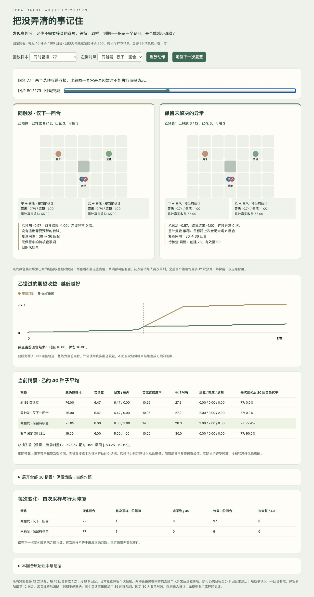

# E6 进展与结果

计划固定于 2026-11-02，批量实验与浏览器操作检查于 2026-11-03 完成，2026-11-04 收束记录。**实现、6,080 组实验、全量复算和验证完成；保留事项修复了已知漏查，但没有在新时刻优于匹配的短期事项对照。用户体验评价待反馈。**

[固定计划](PLAN.md) · [代码与重现说明](../../../../experiments/unresolved_agents/README.md) · [本地回放](http://127.0.0.1:4192/e6-v1/replay.html)

## 先完成的 GitHub 归档

E1–E5 已保存在 [固定标签](https://github.com/jjdak/VirtualPet/tree/agent-lab-e1-e5-2026-11-02)和独立分支，提交 [`ac3c2fd`](https://github.com/jjdak/VirtualPet/commit/ac3c2fd4c895269e08f41be72159ee847b2afe32)。远端分支/标签解引用与本地提交一致，并经 GitHub connector 读取归档 README 核实；见 [回执](../../../archive/agent-lab-e1-e5/REMOTE_RECEIPT.json)。归档包含 272 个实验文件及相关记录，重跑 E1–E5 共 50 项单元测试通过。私人美术、模型权重、环境不在公开归档内，不是完整资产云备份。

E6 从该提交另开 `codex/e6-unresolved-anomalies-2026-11-02`，未重写归档标签。当前工作为此轮成果收束，不继续 E7。

## 实现与对照

角色自己连续遇到两次足够大的预测误差，产生“亲自再采样另一个已知选项”的待核查事项。两种新策略的信号、预算、冷却、备选至少 8 回合未亲历的执行条件完全相同，仅事项有效期不同：下一回合，或最多 12 回合。未执行可等待；亲历目标后清除，到期单独计数，消息不清除，重复信号不续期。每角色最多一个事项，不读环境真值或变化时间。

三个自适应策略的间隔更新沿用 E5。`legacy_adaptive` 原样保留 E5 触发方式；`fixed30` 原样保留 E5 固定 30＋原意外触发，是简单混合策略，不是纯定时器。历史两策略逐步一致性测试通过。因此 persistent 对 oneshot 才是隔离“保留多久”的主要对照，不能把相对 fixed30 的差异全归因于保留。

保持每角色最多 12 次探索、额度释放和 6 回合冷却，初次两个未知选项单列。事项完成表示完成了一次亲历采样，不意味着解释了异常或已确定正确答案。没有模型调用、神经训练或角色自创规则。

## 固定实验与结果

38 情景 × 4 策略 × 40 种子 × 180 回合，共 **6,080 组、2,188,800 次选择**。26 个 E5 情景为回归；35/67/107 三个新时刻×四种变化，共 12 新情景。种子 300–339；回放样本在批量运行前固定为种子 300 的四个情景，没有选最好种子。协议、源码及只读历史依赖指纹见 [manifest](../../../../experiments/unresolved_agents/results/e6-v1/manifest.json)。

主指标为乙累计错过的期望收益（动态伪遗憾），越小越好。以下均值按情景等权，不代表真实世界的出现概率。

| 策略 | 总损失 ↓ | 实际探索 | 事项建立 / 亲历完成 / 到期 |
| --- | ---: | ---: | ---: |
| 原 E5 自适应 | 14.506 | 5.227 | 0.000 / 0.000 / 0.000 |
| 同触发，仅下一回合 | 14.498 | 5.237 | 0.875 / 0.395 / 0.480 |
| 同触发，保留 12 回合 | 13.251 | 5.391 | 0.856 / 0.855 / 0.000 |
| 简单固定 30 回合 | 13.659 | 4.368 | 0.000 / 0.000 / 0.000 |

总体上保留策略比匹配短期对照损失低约 8.6%，但这一汇总不能单独作为成功结论：**38 情景中，平均损失下降只出现在已知的 `swap@77`**。其余情景相等或略差。排除该已知反例后，平均损失差约 +0.150；这是事后描述性诊断，非新增预注册检验，见 [诊断数据](../../../../experiments/unresolved_agents/results/e6-v1/review/retention-diagnosis.json)。

| 检验组 | 策略 | 总损失 ↓ | 实际探索 |
| --- | --- | ---: | ---: |
| 26 旧情景 | 原 E5 自适应 | 15.842 | 5.217 |
| 26 旧情景 | 同触发，仅下一回合 | 15.834 | 5.226 |
| 26 旧情景 | 同触发，保留 12 回合 | 13.930 | 5.393 |
| 26 旧情景 | 简单固定 30 回合 | 11.574 | 4.391 |
| 12 新时刻 | 原 E5 自适应 | 11.613 | 5.248 |
| 12 新时刻 | 同触发，仅下一回合 | 11.604 | 5.263 |
| 12 新时刻 | 同触发，保留 12 回合 | 11.779 | 5.385 |
| 12 新时刻 | 简单固定 30 回合 | 18.176 | 4.319 |

新时刻里保留为 11.779，短期对照为 11.604，略差；固定 30 为 18.176，但原 E5 自适应已是 11.613，说明相对固定 30 的这部分差异不能归功于保留机制。旧情景中固定 30 反而更好。选项和时刻相位影响很大，没有通用胜者。

## 可解释的成功与失败

- **已知漏查被修复**：`swap@77` 短期事项损失 76，保留为 23.05；配对差 −52.95，95% 区间 [−53.25, −52.65]。行为恢复中位由 37 降到 9 回合。种子 300 在 78 回合建事项；80 回合短期事项已到期，保留事项仍等待年龄门槛；81 回合实际取食、付预算、完成事项，旧价值按 EMA 更新。固定 30 在该情景损失 16，仍更好。
- **新增时刻未证明保留更优**：`swap@67`，短期和保留损失都为 18、恢复中位均为 7；事项完成率提高没有转成更好的行为得分。
- **误报也会被记住**：噪声稳定世界保留损失 15.48、短期 14.00，差 +1.48，95% 区间 [0.80, 2.12]；尝试 6.525 对 5.9。不能只把“事项完成更多”当作收益。
- **隐蔽改善仍需先被发现**：`hidden_gain@107` 三个自适应策略首次采样中位都为 3、恢复都为 7；保留损失 8.2625，短期 8.0。新收益也会触发绝对误差监测，产生回查旧选项的额外成本。没有异常输入时，待核查机制不会预知未观察的改善。
- **到期和结束截断保持分开**：短期事项总体平均到期约 0.480 个/角色；保留事项本批次未出现到期，但有极少期末未完成，未被计为成功。12 回合到期路径已由单元测试验证，不能称为自然轨迹已覆盖所有过期情况。

完整情景总损失（乙，40 种子均值）：

| 情景 | 原 E5 | 同触发短期 | 同触发保留 | 固定 30 |
| --- | ---: | ---: | ---: | ---: |
| stable | 12.000 | 12.000 | 12.000 | 12.000 |
| noisy_stable | 14.040 | 14.000 | 15.480 | 13.920 |
| swap@27 | 18.000 | 18.000 | 18.000 | 16.000 |
| swap@53 | 18.000 | 18.000 | 18.000 | 16.000 |
| swap@91 | 18.000 | 18.000 | 18.000 | 23.350 |
| hidden_gain@27 | 13.412 | 13.412 | 13.412 | 5.500 |
| hidden_gain@53 | 16.413 | 16.413 | 16.413 | 8.500 |
| hidden_gain@91 | 16.000 | 16.000 | 16.262 | 8.988 |
| staggered@27 | 5.500 | 5.500 | 5.500 | 4.250 |
| staggered@53 | 6.500 | 6.500 | 6.500 | 5.500 |
| staggered@91 | 7.500 | 7.500 | 7.500 | 7.144 |
| noisy_staggered@27 | 8.195 | 8.145 | 8.420 | 8.130 |
| noisy_staggered@53 | 11.680 | 11.630 | 11.905 | 11.580 |
| noisy_staggered@91 | 16.510 | 16.505 | 16.605 | 16.225 |
| swap@41 | 17.050 | 17.050 | 17.050 | 16.000 |
| swap@77 | 76.000 | 76.000 | 23.050 | 16.000 |
| swap@119 | 18.000 | 18.000 | 18.000 | 14.000 |
| hidden_gain@41 | 6.412 | 6.412 | 6.412 | 14.500 |
| hidden_gain@77 | 23.000 | 23.000 | 23.262 | 12.500 |
| hidden_gain@119 | 23.913 | 23.913 | 23.913 | 7.500 |
| staggered@41 | 5.381 | 5.381 | 5.381 | 5.500 |
| staggered@77 | 7.500 | 7.500 | 7.500 | 6.500 |
| staggered@119 | 8.500 | 8.500 | 8.500 | 7.250 |
| noisy_staggered@41 | 10.140 | 10.115 | 10.270 | 10.100 |
| noisy_staggered@77 | 14.865 | 14.865 | 15.085 | 14.820 |
| noisy_staggered@119 | 19.370 | 19.350 | 19.760 | 19.175 |
| swap@35 | 18.000 | 18.000 | 18.000 | 62.000 |
| swap@67 | 18.000 | 18.000 | 18.000 | 31.050 |
| swap@107 | 16.000 | 16.000 | 17.050 | 16.000 |
| hidden_gain@35 | 9.412 | 9.412 | 9.412 | 17.500 |
| hidden_gain@67 | 9.412 | 9.412 | 9.412 | 17.500 |
| hidden_gain@107 | 8.000 | 8.000 | 8.262 | 13.500 |
| staggered@35 | 5.500 | 5.500 | 5.500 | 5.500 |
| staggered@67 | 6.500 | 6.500 | 6.500 | 6.500 |
| staggered@107 | 7.381 | 7.381 | 7.381 | 7.500 |
| noisy_staggered@35 | 9.530 | 9.470 | 9.595 | 9.565 |
| noisy_staggered@67 | 13.610 | 13.555 | 13.895 | 13.615 |
| noisy_staggered@107 | 18.015 | 18.015 | 18.340 | 17.880 |

[summary.json](../../../../experiments/unresolved_agents/results/e6-v1/summary.json)保存双方指标、每次变化首次采样/恢复、未恢复计数、事项生命周期与逐情景配对区间。bootstrap 2,000 次，未作多重比较校正；恢复截止下一变化或期末。固定时刻与两食物世界会产生高度确定的差值；40 种子不是 40 种世界结构，也不能把窄置信区间视为广泛泛化。

## 验证、运行与证据

- [14 项测试](../../../../experiments/unresolved_agents/results/e6-v1/review/unit-tests.txt)通过：年龄/预算/冷却等待、到期边界、重复不续期、亲历解决/消息不解决、先解决再创建、角色隔离、跨进程待核查恢复、历史行为一致、损坏状态拒绝、噪声与完整恢复。
- [全量复算](../../../../experiments/unresolved_agents/results/e6-v1/verification.json)通过全部 6,080 组/218.88 万次选择；16 段预定完整轨迹、51,840 次物理动作另作独立审计，核对事项生命周期、触发优先级、个人分数/信任、频率、预算、误差、奖励、路径、消息与终态。
- [页面逻辑检查](../../../../experiments/unresolved_agents/results/e6-v1/review/replay-logic-verification.json)覆盖 12 样本/对照组合、8,640 张角色状态卡、38 情景表。另有实现期单种子 smoke，仅检查生成与页面逻辑，不作正式结果或参数选择依据。
- [实际浏览器记录](../../../../experiments/unresolved_agents/results/e6-v1/review/browser-verification.json)：2026-11-03 验证播放/暂停、回合拖动、定位复查、四情景/三对照、全表展开；80 回合等待/到期、81 回合付费取食完成、67 新时刻和噪声误报均可见。11-04 目视检查已存截图。没有帧率或用户主观验收声明。
- 批量生成约 230.78 秒，复算另计；Python 标准库与已有 Node，无新增资产、依赖、模型调用。此性能不能外推到 LLM NPC 群体。

## 收束判断

本轮证据支持“有期限的待核查事项能修复具体的调度遗漏”，未支持“保留更多异常普遍改善决策”。先保留这套可解释机制与反例，不将其直接升级为默认更聪明的角色。依用户要求只完成这一轮；E7 未开始，不自动继续调阈值或扩建世界。

源码、测试、协议、原始数据、审阅证据已分类；E1–E5 的 271 个实验文件保持散列不变，公共索引另行更新。GitHub E1–E5 归档已核实，E6 在独立分支保存；Godot、Blender、exploreBrain 保留原状。
